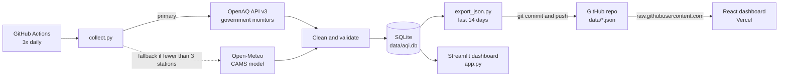

# Delhi-NCR Air Quality Tracker

[](https://github.com/Divyanshukumar2005/delhi-aqi-pipeline/actions/workflows/collect.yml)


**An automated data pipeline that collects hourly air-quality readings from 30 government monitoring stations across Delhi-NCR, computes India's official CPCB AQI, and serves it on a live dashboard. It runs three times a day with no manual steps.**

### 🔗 [Live dashboard](https://delhi-aqi-pipeline-g3tm.vercel.app/)

<!-- After you save a screenshot as docs/dashboard.png, remove this comment line and the closing one below to show it:

-->

---

## Overview

Air quality in Delhi-NCR changes by the hour and differs a lot from one neighbourhood to the next. This project answers "how bad is it right now, where, and how does it compare with earlier days?" using real monitor data rather than model estimates.

| | |
|---|---|
| **Coverage** | 30 CPCB / DPCC / IMD / state-board monitors in Delhi, Gurugram, Noida, Faridabad and Bahadurgarh |
| **Pollutants** | PM2.5, PM10, NO₂, O₃ (hourly) |
| **Data volume** | ~53,600 hourly readings, 92 days of history (1 Aug 2026 onwards), growing 3× daily |
| **Automation** | GitHub Actions at 08:00, 14:00 and 20:00 IST; tests run before every collection |
| **AQI method** | CPCB National AQI from 24-hour rolling PM2.5 / PM10 averages |
| **Quality** | 46 automated tests; idempotent loads; automatic fallback data source |

## Features

- **Reliable ingestion:** OpenAQ API v3 client with rate-limit handling (HTTP 429), retries with exponential backoff, and per-station error isolation so one failing station never stops a run.
- **Idempotent storage:** a composite primary key plus `INSERT OR IGNORE` means re-running any job can never create duplicates. Each run re-fetches 48 hours, so a missed run heals itself.
- **Data cleaning:** future hours dropped, physically impossible values (sensor error codes) set to NULL using documented thresholds.
- **Official AQI:** the CPCB sub-index method with the 16-valid-hours rule, unit-tested against CPCB's own worked example.
- **Automatic fallback:** if the OpenAQ key is missing or fewer than 3 stations respond, the pipeline adds model-based CAMS data from Open-Meteo. Every row carries a `source` column and the dashboard labels model data clearly.
- **Live dashboard (React):** multiple views including map and station rankings, hour-of-day heatmap, pollutant trends, station deep-dive, side-by-side comparison, a 24-hour forecast and computed insights, with light and dark themes and CSV export.
- **Second dashboard (Streamlit):** a Python-only version of the same views that reads the full database, useful for analysis over the whole history.

## Architecture



**Why this design:** the whole system runs on free tiers (GitHub Actions, Vercel, OpenAQ). The database lives in the repo, so the commit history doubles as an audit trail of every data update. The React dashboard fetches fresh JSON straight from the repo, so it updates itself without being redeployed.

## Tech stack

| Layer | Tools |
|---|---|
| Data collection | Python 3.11, requests, OpenAQ API v3, Open-Meteo API |
| Processing and analysis | pandas, NumPy, SciPy (Welch's t-test, Pearson correlation) |
| Storage | SQLite |
| Automation and CI | GitHub Actions (scheduled runs, pytest gate, bot commits) |
| Dashboards | React 19, TypeScript, Vite, Tailwind CSS (`web/`); Streamlit + Plotly (`app.py`) |
| Hosting | Vercel (React), GitHub (data) |
| Testing | pytest, 46 offline tests with mocked APIs |

## Insights

The dashboard computes these live from the data. Snapshot from 31 Oct 2026, 16:00 IST:

- **Basin-wide AQI: 109 (Moderate)** across 30 stations.
- **Most polluted:** Jahangirpuri, Delhi (AQI 260, Poor). **Cleanest:** Lodhi Road, Delhi (AQI 31, Good).
- By sub-region, Delhi (118) was worse than Gurugram (76), Noida (93), Faridabad (78) and Bahadurgarh (82).

The Diwali 2026 comparison (7 days before vs 7 days from 8 Nov) is computed automatically once enough days have been collected and will be added here after mid-November.

## Quick start

**Prerequisites:** Python 3.11, Git, a current Node.js LTS, v20.19 or newer (only for the React dashboard), and a free [OpenAQ API key](https://explore.openaq.org/register).

```bash
git clone https://github.com/Divyanshukumar2005/delhi-aqi-pipeline.git
cd delhi-aqi-pipeline

python -m venv .venv
source .venv/bin/activate          # Windows PowerShell: .venv\Scripts\Activate.ps1
pip install -r requirements.txt

cp .env.example .env               # then paste your key after OPENAQ_API_KEY=

python src/discover.py             # find active stations -> data/stations.json
python src/backfill.py             # one-time, ~90 days of history (a few minutes)
python src/collect.py              # the regular job (last 48 hours)
python src/export_json.py          # JSON for the React dashboard
pytest                             # 46 tests should pass
```

**Run the dashboards locally**

```bash
streamlit run app.py               # Streamlit, http://localhost:8501

cd web && npm install && npm run dev    # React, http://localhost:3000
```

By default the React app reads live data from this repo. To point it at your own fork, set `VITE_DATA_BASE_URL` (for example `https://raw.githubusercontent.com/<you>/<repo>/main/data`).

## Deploy your own copy

1. **Fork or push** this repo to your GitHub account (keep it **public** so Actions is free and the raw data URL works).
2. **Add the secret:** *Settings → Secrets and variables → Actions → New repository secret*, name `OPENAQ_API_KEY`.
3. **Allow the bot to commit:** *Settings → Actions → General → Workflow permissions → Read and write permissions*.
4. **Run the workflow once:** *Actions → Collect Delhi AQI data → Run workflow* (tick **backfill** if you have not run it locally). It must finish with a green tick. From then on it runs automatically.
5. **Deploy the React dashboard:** on [vercel.com](https://vercel.com) choose *Add New Project*, pick the repo, set **Root Directory** to `web` (Vite is auto-detected) and deploy. No environment variables are needed.
6. *(Optional)* Deploy `app.py` on [Streamlit Community Cloud](https://share.streamlit.io) for the Python dashboard.

**Verify it works:** the latest Actions run is green and shows a new `data: update AQI readings` commit by `github-actions[bot]`; opening `data/readings.json` through `raw.githubusercontent.com` returns data; the dashboard's "Last ingested" time moves forward after each scheduled run (allow up to 5 minutes for GitHub's cache).

### Troubleshooting

| Problem | Cause | Fix |
|---|---|---|
| Workflow fails at push with **403** | Workflow cannot write to the repo | Set **Read and write permissions** (step 3) |
| OpenAQ **401 / 403** in the log | Key missing, wrong, or has spaces | Re-copy the key into `.env` and the secret named exactly `OPENAQ_API_KEY` |
| **429 Too Many Requests** | Free limit (60/min, 2,000/hour) reached | The client waits and retries; avoid running backfill several times in one hour |
| Run happens at an unexpected time | GitHub cron uses **UTC**, and runs can start 5 to 30 minutes late | `30 2,8,14 * * *` = 08:00, 14:00, 20:00 IST |
| `stations.json` empty / no active stations | Stations were offline during discovery | Run `python src/discover.py` again later; the collector uses the fallback meanwhile |
| React dashboard shows older data than expected | GitHub caches raw files for about 5 minutes | Wait and refresh; if GitHub is unreachable the app shows the bundled copy |
| Vercel build fails / blank page | Wrong root directory | Set **Root Directory** to `web` in Vercel project settings |
| Streamlit app "has gone to sleep" | Free apps sleep after inactivity | Click *Yes, get this app back up* (about 30 seconds) |

> **Keep-alive note:** GitHub can disable scheduled workflows on public repos after 60 days without repository activity, and bot commits may not count as activity. Check the Actions tab now and then; if a "workflow disabled" banner appears, click **Enable workflow**.

## How the CPCB AQI is computed

1. For each station, take the **24-hour rolling mean** of PM2.5 and PM10. A value is produced only when the window has **at least 16 valid hours** (CPCB rule).
2. Convert each mean to a **sub-index** by linear interpolation inside its breakpoint band:
   `I = I_lo + (I_hi - I_lo) / (C_hi - C_lo) x (C - C_lo)`
   For example, PM2.5 = 45 µg/m³ gives 50 + 50/30 x 15 = **75** (CPCB's own worked example).
3. **AQI = the larger sub-index**, rounded and capped at 500.

| Category | AQI | PM2.5 (24h, µg/m³) | PM10 (24h, µg/m³) |
|---|---|---|---|
| Good | 0-50 | 0-30 | 0-50 |
| Satisfactory | 51-100 | 31-60 | 51-100 |
| Moderate | 101-200 | 61-90 | 101-250 |
| Poor | 201-300 | 91-120 | 251-350 |
| Very Poor | 301-400 | 121-250 | 351-430 |
| Severe | 401-500 | 250+ | 430+ |

## Limitations

- **Station outages and gaps:** monitors go offline, hours with missing data are simply absent, and an AQI needs 16 of 24 hours.
- **PM-only AQI:** the official CPCB index uses up to 8 pollutants (minimum 3 including a PM). This project uses PM2.5 and PM10, which drive Delhi's AQI almost always; NO₂ and O₃ are shown for context.
- **Fallback is model-based:** Open-Meteo / CAMS values are modelled on a coarse grid (roughly 45 km over India), so nearby "stations" look almost identical. They are always labelled "(model)".
- **Web dashboard window:** the React dashboard shows the latest 14 days to keep loading fast; the full history is in `data/aqi.db` and the Streamlit dashboard.
- **Forecast is a baseline:** the 24-hour forecast is a simple statistical projection (recent level plus typical hour-of-day pattern), not a trained model.
- **Correlation, not causation:** the weekday vs weekend test cannot separate traffic from weather.
- **Time labels:** OpenAQ aggregates in UTC hours, so some stations show half-hour IST labels (for example 13:30).

## Assumptions

- **Station choice:** stationary OpenAQ **reference monitors** within 25 km (the API maximum) of 28.54, 77.13 that have a PM2.5 sensor and reported within the last 24 hours; up to 30 are kept. Low-cost sensors are excluded so comparisons are fair.
- **Hourly data:** OpenAQ's precomputed `/v3/sensors/{id}/hours` endpoint, each hour labelled by its start time converted to IST.
- **Units:** gases reported in ppm / ppb are converted to µg/m³ at 25 °C.
- **Sanity limits (µg/m³):** negative values, or above PM2.5 1500, PM10 2500, NO₂ 1000, O₃ 1000, are treated as missing (`src/config.py`).
- **Severe band:** CPCB only states "250+" and "430+"; the same band width as Very Poor is assumed and the AQI is capped at 500.
- **Diwali window:** "before" is the 7 days up to 7 Nov 2026 and "after" is 8 to 14 Nov (Diwali night counts as after); shown only when each side has enough days.
- **Weekday vs weekend test** uses daily city averages because consecutive hours are not independent.

## Future work

- Alerts (email or Telegram) when AQI crosses "Very Poor".
- A trained forecasting model (for example gradient boosting) for next-day AQI.
- Weather features (wind, temperature, boundary-layer height) to explain pollution spikes.
- Stubble-burning fire counts (NASA FIRMS) as an explanatory variable.

## Data sources and attribution

- **[OpenAQ](https://openaq.org):** open air-quality data platform; Delhi data originates from government monitors (CPCB, DPCC, IMD and state pollution control boards). Each provider's licence applies.
- **Copernicus Atmosphere Monitoring Service (CAMS):** "Generated using Copernicus Atmosphere Monitoring Service information." Model data used only as a fallback, accessed through **[Open-Meteo](https://open-meteo.com)** (CC BY 4.0).
- **AQI method:** Central Pollution Control Board, *National Air Quality Index*, CUPS/82/2014-15 ([report](https://smartnet.niua.org/sites/default/files/resources/Air%20Quality%20Index.pdf), [summary with worked examples](https://ies.gov.in/arthapedia/concept/national-air-quality-index), [CPCB](https://cpcb.nic.in)).

## Project structure

```
delhi-aqi-pipeline/
├── .github/workflows/collect.yml   # scheduled collection, tests, export, bot commit
├── src/
│   ├── config.py           # constants, CPCB breakpoints, paths, thresholds
│   ├── db.py               # SQLite: create table, idempotent insert, load
│   ├── openaq_client.py    # OpenAQ v3 calls, rate limits, retries
│   ├── openmeteo_client.py # fallback source (CAMS model)
│   ├── discover.py         # find and save active stations
│   ├── find_station.py     # helper to look up stations near a point
│   ├── collect.py          # regular collector (last 48 h)
│   ├── backfill.py         # one-time history pull
│   ├── export_json.py      # SQLite -> data/readings.json for the web app
│   ├── analysis.py         # CPCB AQI and insight functions
│   └── forecast.py         # 24-hour statistical forecast
├── tests/                  # 46 offline tests (APIs mocked)
├── data/                   # aqi.db, stations.json, readings.json (committed)
├── web/                    # React + TypeScript dashboard (deployed on Vercel)
├── app.py                  # Streamlit dashboard
├── requirements.txt
└── README.md
```

## License

MIT. See [LICENSE](LICENSE).

## Author

**Divyanshu**, B.Tech (Electronics and Communication Engineering), University of Delhi. [GitHub](https://github.com/Divyanshukumar2005)
