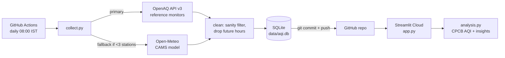

# 🌫️ Delhi AQI Tracker

**A self-updating data pipeline that collects hourly air-quality data from real Delhi monitoring stations every day, stores it in SQLite, and shows a live dashboard with auto-computed insights on India's CPCB AQI scale.**

🔗 **Live demo:** `https://<your-app-name>.streamlit.app` ← paste your link here after deploying

---

## ✅ Manual Setup Checklist

Everything you must do by hand (details in the Setup Guide below):

- [ ] Install Python 3.11, Git and VS Code
- [ ] Register at OpenAQ and copy your free API key
- [ ] Create a **public** GitHub repo called `delhi-aqi-pipeline` and push these files
- [ ] Add the key as a GitHub secret named `OPENAQ_API_KEY`
- [ ] Set **Workflow permissions → Read and write permissions**
- [ ] Run the pipeline locally once (discover → backfill → collect → dashboard)
- [ ] Commit `data/aqi.db` and `data/stations.json`, push, run the workflow manually once (must be green ✅)
- [ ] Deploy the dashboard on Streamlit Community Cloud and paste the link at the top of this README
- [ ] Check the **Actions** tab once a week
- [ ] After 3–4 weeks, copy your real numbers into **Key insights** and **Resume bullets**

---

## 🛠️ Setup Guide

### 1. Install the tools
1. **Python 3.11**: download from <https://www.python.org/downloads/> (pick a 3.11.x version). On Windows, tick **"Add python.exe to PATH"** in the installer.
2. **Git**: <https://git-scm.com/downloads> (accept the defaults).
3. **VS Code**: <https://code.visualstudio.com/>, then install the **Python** extension.
4. Check in a terminal:
   ```bash
   python --version   # should say Python 3.11.x  (on macOS/Linux you may need python3.11)
   git --version
   ```

### 2. Get your free OpenAQ API key
1. Go to <https://explore.openaq.org/register> and create an account (free, no card).
2. Confirm your email, log in, and open your **account / settings** page.
3. Copy the **API key**. Keep it private – never paste it into code.

### 3. Create the GitHub repository
1. On <https://github.com> click **+ → New repository**.
2. Name: `delhi-aqi-pipeline`, visibility **Public** (GitHub Actions is free and unlimited for public repos). Do **not** add a README (we have one). Click **Create repository**.
3. In your terminal:
   ```bash
   git clone https://github.com/<your-username>/delhi-aqi-pipeline.git
   cd delhi-aqi-pipeline
   ```
4. Copy **all** project files into this folder (including the hidden `.github`, `.gitignore`, `.env.example`).
5. Push:
   ```bash
   git add .
   git commit -m "Initial commit: Delhi AQI pipeline"
   git push
   ```

### 4. Add the API key as a GitHub secret
1. In your repo: **Settings → Secrets and variables → Actions → New repository secret**.
2. Name: `OPENAQ_API_KEY` (exactly this). Secret: paste your key. Click **Add secret**.

### 5. Let the workflow push data
**Settings → Actions → General →** scroll to **Workflow permissions → select "Read and write permissions" → Save**.

### 6. Run it locally
From the repo folder:
```bash
# create and activate a virtual environment
python -m venv .venv
# Windows (PowerShell):      .venv\Scripts\Activate.ps1
# macOS / Linux:             source .venv/bin/activate

pip install -r requirements.txt

# add your key
cp .env.example .env          # Windows: copy .env.example .env
# open .env in VS Code and paste your key after OPENAQ_API_KEY=

python src/discover.py        # finds up to 8 active Delhi stations -> data/stations.json
python src/backfill.py        # one-time: ~90 days of history (about 2-5 minutes)
python src/collect.py         # the daily job (last 48 hours)
pytest                        # all tests should pass
streamlit run app.py          # opens the dashboard at http://localhost:8501
```
`python -m src.collect` works too.

### 7. Commit the data and test the workflow
```bash
git add data/aqi.db data/stations.json
git commit -m "Add initial data"
git push
```
Then on GitHub: **Actions → Collect Delhi AQI data → Run workflow → Run workflow**. Wait 1–3 minutes; it must finish with a green ✅. (Tick **backfill** only if you skipped step 6.)

From now on it runs **every day at 08:00 IST** by itself.

### 8. Deploy the dashboard (free)
1. Go to <https://share.streamlit.io> and **sign in with GitHub**.
2. Click **Create app → Deploy a public app from GitHub** (wording may vary slightly; look for "New app").
3. Repository: `<your-username>/delhi-aqi-pipeline`, Branch: `main`, Main file path: `app.py`.
4. Optional: under **Advanced settings**, choose Python **3.11**.
5. Click **Deploy**. Copy the app URL into the top of this README.

**How it stays fresh:** every day the workflow commits a new `data/aqi.db`. Streamlit Cloud notices the new commit and reloads the app; the dashboard also re-reads the database at most once an hour (`st.cache_data(ttl=3600)`).

### 9. Verify everything works
- **Actions tab**: latest run is green; its "Collect the last 48 hours" log says `Done. N rows fetched`.
- **Commits**: a new commit `data: update AQI readings …` by `github-actions[bot]` appears daily (unless no new hours were available).
- **Dashboard**: "Last updated (IST)" is within the last day; there is no yellow "model fallback" banner (if there is, OpenAQ data was not available – see Troubleshooting).
- **Tests**: `pytest` shows all tests passed.

### 🧯 Troubleshooting

| Problem | Cause | Fix |
|---|---|---|
| Workflow fails at push with **403** / "Permission denied to github-actions[bot]" | Workflow can't write | Step 5: set **Read and write permissions** |
| `sqlite3.OperationalError: no such table` | Fresh/empty DB | Run `python src/collect.py` once. The code creates the table automatically; the dashboard shows "No data yet" instead of crashing |
| Log says **OpenAQ returned 401/403** | Key missing, wrong or has spaces | Re-copy the key into `.env` / the GitHub secret named exactly `OPENAQ_API_KEY` |
| **429 Too Many Requests** in the log | Free limit (60/min, 2,000/hour) hit | Nothing to do – the client waits for the `x-ratelimit-reset` time and retries. Don't run backfill several times in one hour |
| Workflow ran at "the wrong time" | GitHub cron is **UTC** | `30 2 * * *` = 02:30 UTC = 08:00 IST. Scheduled runs can also start 5–30 minutes late when GitHub is busy |
| `stations.json` is empty / "No active stations found" | Stations were offline at discovery time | Run `python src/discover.py` again later. Meanwhile the collector uses the Open-Meteo fallback |
| Dashboard says "This app has gone to sleep" | Free apps sleep after days without visitors | Click **"Yes, get this app back up"**; it wakes in ~30 seconds |
| Dashboard shows old data | Cache (1 h) or redeploy pending | Wait up to an hour or use **⋮ → Reboot app** on Streamlit Cloud |

> **Keep-alive note:** GitHub automatically **disables scheduled workflows in public repos after 60 days without repository activity**. Commits made by the workflow bot may not count as activity, so the schedule can pause even while data is flowing. **Check the Actions tab weekly**; if you see a "workflow disabled" banner, click **Enable workflow**.

---

## 📊 For recruiters

### What it does
- **Collects** hourly PM2.5, PM10, NO₂ and O₃ for up to 8 government reference monitors around central Delhi (OpenAQ API v3), every day at 08:00 IST via GitHub Actions.
- **Stores** raw concentrations in SQLite with an idempotent `INSERT OR IGNORE` design (re-runs never create duplicates).
- **Computes** the official Indian (CPCB) AQI from 24-hour rolling PM averages (≥16 valid hours).
- **Shows** a live Streamlit + Plotly dashboard with statistically tested insights (Welch's t-test, Pearson correlation).
- **Falls back** automatically to CAMS model data (Open-Meteo) if fewer than 3 real stations respond, and labels it clearly.

### Architecture


### Tech stack
Python 3.11 · requests · pandas · SciPy · SQLite · Streamlit · Plotly · pytest · GitHub Actions · Streamlit Community Cloud — all free.

### Screenshots
_Add 2–3 screenshots here (e.g. `docs/dashboard.png`): the top metrics, the daily trend chart, and the insights section._

### Key insights
_After 3–4 weeks of data, open the dashboard, read the **Insights** section, and replace the blanks below with your real numbers:_

- Most polluted station: **____** (mean AQI ____), least polluted: **____** (____).
- Air is worst around **__:00 IST** and cleanest around **__:00 IST**.
- Diwali 2026 (8 Nov): mean AQI went from **____** in the 7 days before to **____** after (**__%**).
- Weekday vs weekend: difference of **____** AQI points, p = **____** (significant / not significant).
- PM2.5 vs NO₂ correlation: r = **____**.

### Data sources & attribution
- **OpenAQ** (<https://openaq.org>) – open air-quality data platform; Delhi data originates from government monitors (CPCB / DPCC / IMD). Each provider's licence applies; see the location's `licenses` field in the API.
- **Copernicus Atmosphere Monitoring Service (CAMS)** – "Generated using Copernicus Atmosphere Monitoring Service information." Model data accessed through
- **Open-Meteo** (<https://open-meteo.com>) Air Quality API, licensed **CC BY 4.0**.
- AQI method: **Central Pollution Control Board (CPCB)**, *National Air Quality Index*, CUPS/82/2014-15 (2014) – report copy: <https://smartnet.niua.org/sites/default/files/resources/Air%20Quality%20Index.pdf>; government summary with worked examples: <https://ies.gov.in/arthapedia/concept/national-air-quality-index>; publisher: <https://cpcb.nic.in>.

### How the CPCB AQI is computed
1. For each station, take the **24-hour rolling mean** of PM2.5 and PM10. A value is only produced when the window has **at least 16 valid hours** (CPCB rule).
2. Convert each mean into a **sub-index** by straight-line interpolation inside its breakpoint band:
   `I = I_lo + (I_hi − I_lo) / (C_hi − C_lo) × (C − C_lo)`
   e.g. PM2.5 = 45 µg/m³ → 50 + 50/30 × 15 = **75** (CPCB's own example).
3. **AQI = the larger sub-index**, rounded, capped at 500.

| Category | AQI | PM2.5 (24h) | PM10 (24h) |
|---|---|---|---|
| Good | 0–50 | 0–30 | 0–50 |
| Satisfactory | 51–100 | 31–60 | 51–100 |
| Moderate | 101–200 | 61–90 | 101–250 |
| Poor | 201–300 | 91–120 | 251–350 |
| Very Poor | 301–400 | 121–250 | 351–430 |
| Severe | 401–500 | 250+ | 430+ |

### Limitations
- **Station outages & gaps:** monitors go offline; hours with missing data are simply absent, and AQI needs 16 of 24 hours.
- **PM-only AQI:** official CPCB AQI uses up to 8 pollutants (min. 3). We use PM2.5 and PM10, which drive Delhi's AQI almost always; NO₂ and O₃ are shown for context only.
- **Fallback is model-based:** Open-Meteo/CAMS values are forecasts on a ~45 km grid, so nearby "stations" can look nearly identical. They're clearly marked "(model)".
- **Time labels:** each hour is labelled by its start time in IST; OpenAQ aggregates in UTC hours, so some stations show half-hour IST labels (e.g. 13:30).
- **Statistics:** the weekday/weekend test is correlational – weather, not traffic, can explain differences.

### Future work
- Alerts (email/Telegram) when AQI crosses "Very Poor".
- A forecasting model (e.g. gradient boosting) for next-day AQI.
- Add weather features (wind speed, temperature, boundary layer height) to explain pollution spikes.
- Stubble-burning fire counts (NASA FIRMS) as an explanatory variable.

### Assumptions
- **Station choice:** stationary OpenAQ locations within 25 km (the API maximum) of 28.6139, 77.2090 that are **reference monitors** (`isMonitor = true`), have a PM2.5 sensor and reported PM2.5 in the last 24 h; closest 8 kept. Low-cost sensors are excluded so comparisons are fair (if no monitors exist at all, all PM2.5 locations are used).
- **Hourly data:** OpenAQ's precomputed `/v3/sensors/{id}/hours` endpoint is used; each hour is labelled by `period.datetimeFrom` converted to IST.
- **Units:** gases reported in ppm/ppb are converted to µg/m³ at 25 °C (24.45 L/mol).
- **Sanity limits (µg/m³):** negative values or above PM2.5 1500, PM10 2500, NO₂ 1000, O₃ 1000 are treated as missing (`src/config.py`).
- **Severe band upper limits:** CPCB only says "250+" / "430+"; we assume the same width as the Very Poor band (PM2.5 250–380, PM10 430–510) and cap AQI at 500.
- **Fallback trigger:** OpenAQ rows are kept even when the fallback runs; both are stored side by side and distinguished by the `source` column.
- **Diwali window:** "before" = 1–7 Nov 2026, "after" = 8–14 Nov 2026 (Diwali night is when firecrackers peak, so it counts as "after"). Shown only when each side has ≥ 4 days.
- **Weekday/weekend test** uses daily city averages (not hours) because consecutive hours are not independent; it needs ≥ 5 weekdays and ≥ 3 weekend days.
- **Collection window:** daily run re-fetches 48 h so one missed day heals itself; backfill pulls 90 days (Open-Meteo allows max 92).

### Project structure
```
delhi-aqi-pipeline/
├── .github/workflows/collect.yml   # daily schedule + manual run with optional backfill
├── src/
│   ├── __init__.py
│   ├── config.py           # constants, CPCB breakpoints, paths, thresholds
│   ├── db.py               # SQLite: create table, insert (idempotent), load
│   ├── openaq_client.py    # OpenAQ v3 calls, rate limits, retries
│   ├── openmeteo_client.py # fallback source (CAMS model)
│   ├── discover.py         # find and save Delhi stations
│   ├── collect.py          # daily collector (last 48 h)
│   ├── backfill.py         # one-time 90-day history pull
│   └── analysis.py         # CPCB AQI + insight functions
├── tests/                  # offline tests (APIs mocked)
│   ├── test_db.py
│   ├── test_aqi.py
│   └── test_collect.py
├── data/                   # aqi.db + stations.json (committed)
├── app.py                  # Streamlit dashboard
├── pytest.ini
├── requirements.txt
├── .env.example
├── .gitignore
├── LICENSE
└── README.md
```

---

## 📝 Resume bullets
Fill the blanks with your real numbers after a few weeks:

1. Built an automated **Python ETL pipeline** (OpenAQ API → SQLite, GitHub Actions) that collects hourly air-quality data from **__** Delhi monitoring stations daily, storing **__,___+** hourly readings over **__** days with idempotent loads, rate-limit handling and a model-data fallback; covered by **__** pytest tests.
2. Developed a **Streamlit + Plotly dashboard** implementing India's **CPCB AQI** (24-h rolling, 16-hour validity rule) and live statistical insights, finding that **__** was Delhi's most polluted station (mean AQI **__**), AQI peaked at **__:00 IST**, and AQI changed **__%** around Diwali 2026 (Welch's t-test, p = **__**).
