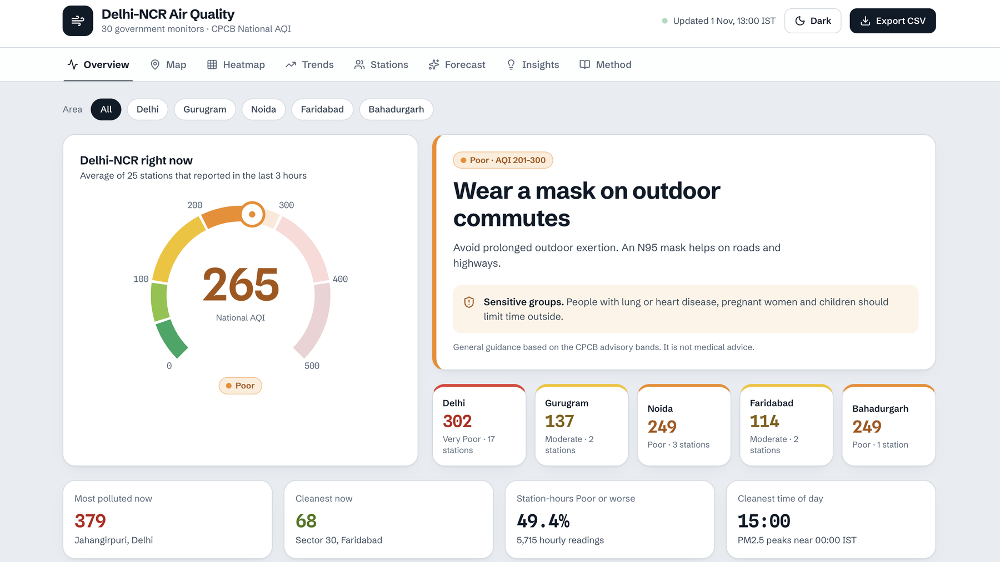
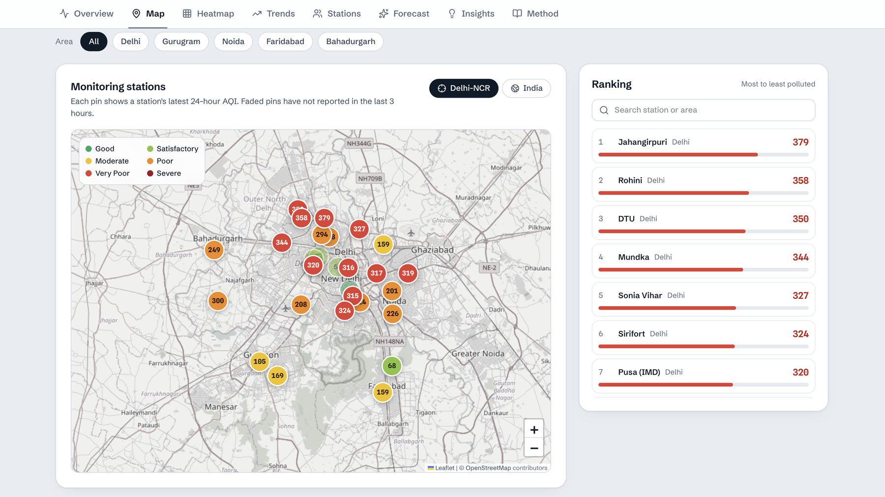
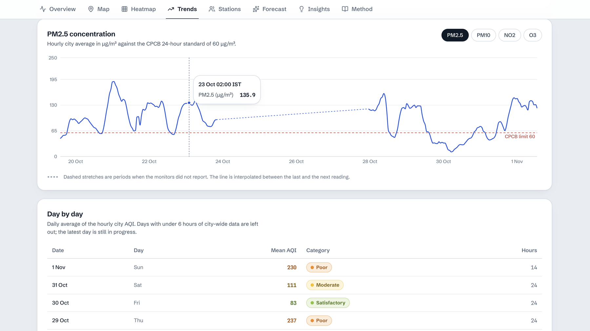
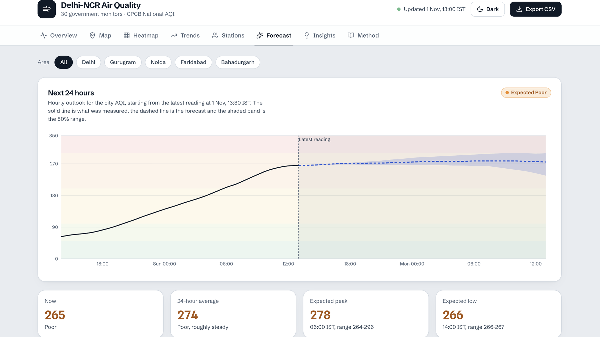
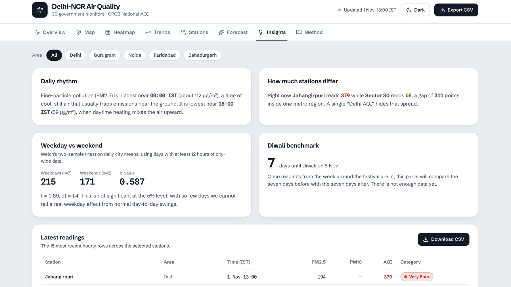
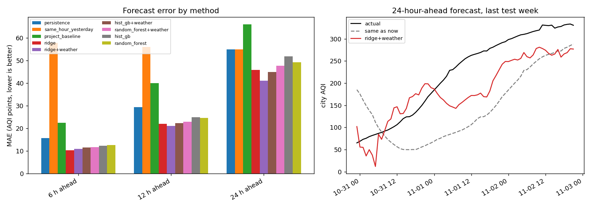
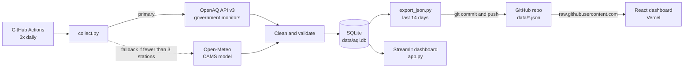

# Delhi-NCR Air Quality Tracker

[](https://delhi-aqi-pipeline-g3tm.vercel.app/)
[](https://github.com/Divyanshukumar2005/delhi-aqi-pipeline/actions/workflows/collect.yml)


**An automated data pipeline that collects hourly air-quality readings from 30 government monitoring stations across Delhi-NCR, computes India's official CPCB AQI, and serves it on a live dashboard. It runs three times a day with no manual steps.**

### 🔗 [Open the live dashboard](https://delhi-aqi-pipeline-g3tm.vercel.app/)

| **30** | **54,000+** | **3x per day** | **117** |
|:---:|:---:|:---:|:---:|
| government monitoring stations | hourly readings stored | automated runs, no manual steps | tests passing in CI |




---

## Overview

Air quality in Delhi-NCR changes by the hour and differs a lot from one neighbourhood to the next. This project answers "how bad is it right now, where, and how does it compare with earlier days?" using real monitor data rather than model estimates. The goal was a complete, production-style data project (ingest, validate, store, analyse, serve) that runs entirely on free infrastructure.

| | |
|---|---|
| **Coverage** | 30 CPCB / DPCC / IMD / state-board monitors in Delhi, Gurugram, Noida, Faridabad and Bahadurgarh |
| **Pollutants** | PM2.5, PM10, NO₂, O₃ (hourly) |
| **Data volume** | 54,000+ hourly readings and 90+ days of history (from 1 Aug 2026), growing three times a day |
| **Automation** | GitHub Actions at 08:00, 14:00 and 20:00 IST; tests run before every collection |
| **AQI method** | CPCB National AQI from 24-hour rolling PM2.5 / PM10 averages |
| **Quality** | 117 automated tests, idempotent loads, automatic fallback data source |

## Dashboard tour

| Station map | Trends |
|---|---|
|  |  |
| **Map and ranking.** Every station on an OpenStreetMap basemap, coloured by its CPCB category. Pins that have not reported recently are faded. | **Trends.** City AQI and each pollutant over time, with the CPCB limit marked. Gaps in reporting are drawn as dashed lines instead of hidden. |

| 24-hour forecast | Insights |
|---|---|
|  |  |
| **Forecast.** A simple baseline (recent level plus the typical hour-of-day pattern) with an 80% range, back-tested against a "stays the same" baseline. | **Insights.** Findings computed live from the data, including a Welch's t-test for weekday vs weekend and a Diwali before/after benchmark. |

The dashboard also has a **Heatmap** tab (city by day and hour, and station by hour), a **Stations** tab for side-by-side comparison, an **ML Forecast** tab with the trained model's 6, 12 and 24 hour predictions and its back-test error, and a **Method** tab that documents the pipeline, the AQI formula and the known limits.

## Features

- **Reliable ingestion:** OpenAQ API v3 client with rate-limit handling (HTTP 429), retries with exponential backoff, and per-station error isolation, so one failing station never stops a run.
- **Idempotent storage:** a composite primary key plus `INSERT OR IGNORE` means re-running any job can never create duplicates. Each run re-fetches 48 hours, so a missed run heals itself.
- **Data cleaning:** future hours dropped, and physically impossible values (sensor error codes) set to NULL using documented thresholds.
- **Official AQI:** the CPCB sub-index method with the 16-valid-hours rule, unit-tested against CPCB's own worked example. The React app recomputes it in the browser from raw concentrations, so every number can be traced back.
- **Automatic fallback:** if the OpenAQ key is missing or fewer than 3 stations respond, the pipeline adds model-based CAMS data from Open-Meteo. Every row carries a `source` column and model data is always labelled.
- **SQL analytics layer:** 15 documented queries (window functions, CTEs, gaps-and-islands, pivots) run directly on the database, with the CPCB AQI re-implemented in SQL and checked against the Python version. See [`sql/`](sql/README.md).
- **ML forecast:** a trained model (ridge regression, random forest, gradient boosting) predicts the city AQI 6, 12 and 24 hours ahead, scored with time-ordered rolling windows against simple baselines. On a 28-day back-test (4 rolling 7-day windows), the best model had 25-35% lower error than "same as now"; small differences at this test length are within noise. See [ML forecast](#ml-forecast).
- **Honest gaps:** when monitors stop reporting, charts show a dashed interpolated stretch and tables and statistics use only real readings.
- **Two dashboards:** a React app for the public view and a Python-only Streamlit app that reads the full database.

## SQL analytics

The [`sql/`](sql/README.md) folder holds **15 analytical queries** that run directly on `data/aqi.db`, each with the business question at the top. They cover trends, rankings, sub-region comparisons, hotspots, outage detection, consecutive-day pollution episodes and a Diwali before/after benchmark, using window functions (`RANK`, `NTILE`, `LAG`, moving averages), CTEs, gaps-and-islands and pivots.

```bash
python sql/run.py                  # run all 15 queries
python sql/run.py --only 3 8 9     # run selected queries
```

The CPCB AQI is re-implemented in SQL and tested against the Python implementation: on the real database 50,108 of 50,121 values are identical and the rest differ by one point of floating-point rounding. A few results:

- **Sub-regions:** Gurugram had the highest average AQI since August (128) and Bahadurgarh the lowest (92).
- **Hotspots:** at the same hour, Sector-125 (Noida) ran about 31 points above the city average and Shadipur about 43 below.
- **Outage detection:** 28 stations stopped reporting together for 83 hours, which points to a data-feed problem rather than broken monitors.

## ML forecast

A trained model that predicts the city-mean AQI **6, 12 and 24 hours ahead**, evaluated honestly against simple baselines. The React dashboard's **ML Forecast** tab shows the latest prediction, which the pipeline writes to `data/ml_forecast.json` after each collection run (if that step fails, the tab shows the last file or "not available yet"). The dashboard's **Forecast** tab still shows the statistical baseline.

Back-test on the last 28 days (four consecutive 7-day test windows, 320 to 371 hourly forecasts per horizon). Models marked "+ weather" also use Open-Meteo weather features. Errors are in AQI points, lower is better:

| Method | 6 h MAE | 12 h MAE | 24 h MAE |
|---|---|---|---|
| "Same as now" (persistence) | 15.7 | 29.5 | 54.9 |
| Statistical baseline (`src/forecast.py`) | 22.5 | 40.0 | 66.0 |
| Random forest | 12.6 | 24.6 | 49.2 |
| Gradient boosting | 12.3 | 25.0 | 51.8 |
| Ridge regression | **10.3** | 22.0 | 45.9 |
| Random forest + weather | 11.7 | 23.0 | 47.7 |
| Gradient boosting + weather | 11.5 | 22.3 | 44.9 |
| Ridge regression + weather | 11.0 | **21.1** | **41.1** |

**Effect of weather** (best model with weather vs best model without, same 28-day back-test): at 6 hours weather did not improve the back-test (MAE 10.3 to 11.0, 6.7% higher). At 12 hours it lowered the MAE from 22.0 to 21.1 (4.3%) and at 24 hours from 45.9 to 41.1 (10.4%). The 12-hour change is small enough to be within noise. Possible reasons for the weak result: weather comes from a single point in central Delhi, and the test is only 28 days. The saved models follow the best result per horizon: ridge without weather at 6 hours, ridge with weather at 12 and 24 hours.



**What the results say** (run on data up to 2 Nov 2026; full tables in [`docs/ML_RESULTS.md`](docs/ML_RESULTS.md))

- On a 28-day back-test (4 rolling 7-day windows), ridge regression without weather had 35%, 25% and 16% lower error than "same as now" at 6, 12 and 24 hours. With only four windows, small differences are within noise.
- The tree models did not beat the simple linear model. With about 1,900 hourly values (three months), the simpler model generalises better.
- In this 28-day back-test, the statistical forecast in `src/forecast.py` had a higher error than "same as now". The test weeks were a period of rising pollution, which a forecast that fades back towards the recent average handles badly. (The React dashboard's forecast is a separate implementation with its own back-test on the Forecast tab.)
- **Only hours with enough stations count.** An hour is used as a "city" value only when at least half the usual number of stations reported it. This removes the half-collected newest hour and the 23 to 27 Oct outage, when a single station would otherwise have been the "city". Without this filter the models were trained and scored on that noise.
- The biggest misses are sudden, weather-driven swings, for example the drop in the daily city mean from 237 on 29 Oct to 83 on 30 Oct. Weather features helped at 12 and 24 hours but not at 6 hours (see above), so they explain only part of these swings.

**How it is tested**

- **No look-ahead.** Every feature at hour t uses only data up to t (unit-tested by changing the future and checking the features do not move).
- **Time-ordered folds.** Models are trained on the past only, with a gap of one horizon before each test window. Random splits would leak the future.
- **Predict the change, not the level.** AQI rose sharply from August to November, and tree models cannot predict outside the range they were trained on, so the models predict the change from the current AQI.
- **Fixed settings.** Model settings were chosen in advance and not tuned on the test windows.

**Limits:** a 28-day test period is short and its windows are correlated, so small differences between models are within noise. The with-weather numbers use the weather stored for the target hour, not a forecast issued at prediction time, so they are probably optimistic. There are no prediction intervals yet. Saved models (`data/models/`) belong to the pinned scikit-learn version: `train_forecast.py` writes `data/models/meta.json` (scikit-learn and NumPy versions, training date, rows used, feature names), and the API, `--predict` and the dashboard export refuse to use models trained with a different scikit-learn version. The API then returns `503` with "Models were trained with scikit-learn X; run python src/train_forecast.py to retrain." Models without a `meta.json` are refused the same way.

```bash
pip install -r requirements-ml.txt
python src/fetch_weather.py          # optional: weather features -> data/weather.csv (needs internet)
python src/train_forecast.py         # evaluate, write docs/ML_RESULTS.md, save models to data/models/
python src/train_forecast.py --predict   # latest forecasts from the saved models
python src/export_json.py --ml-only      # write data/ml_forecast.json for the dashboard tab
```

### Forecast API

`api.py` is a small Flask API that serves the latest AQI and the saved model's forecast as JSON.

```bash
python api.py                                   # http://127.0.0.1:5000
curl "http://127.0.0.1:5000/api/forecast?horizon=6"
```

| Endpoint | Returns |
|---|---|
| `GET /health` | status, time of the newest reading, which models are available |
| `GET /api/latest` | latest AQI and category per station, plus the basin-wide figure |
| `GET /api/forecast?horizon=6\|12\|24` | predicted city AQI, its category, the model used and its back-test error |

Bad input returns `400`. A missing model, models trained with another scikit-learn version, or stale data return `503`, each with a message saying what to do.

## Architecture



**Why this design:** the whole system runs on free tiers (GitHub Actions, Vercel, OpenAQ). The database lives in the repo, so the commit history doubles as an audit trail of every data update. The React dashboard fetches fresh JSON straight from the repo, so it updates itself without being redeployed, and it ships a bundled copy of the data as a fallback if GitHub is unreachable.

### What one automated run does

1. Check out the repo and set up Python 3.11.
2. Install dependencies and **run the core tests** (a failing test stops the run before any data changes).
3. Optionally backfill history (manual runs only).
4. Collect the last 48 hours from OpenAQ, with the Open-Meteo fallback if needed.
5. Export the last 14 days to `data/readings.json` for the web dashboard.
6. Commit `aqi.db`, `stations.json` and `readings.json` only if something changed.

## Data model

**SQLite table `readings`** (`data/aqi.db`), one row per station per hour:

| Column | Type | Notes |
|---|---|---|
| `station_id` | TEXT | OpenAQ location id (part of the primary key) |
| `station` | TEXT | Human-readable station name |
| `ts` | TEXT | ISO 8601 in IST, for example `2026-10-30T13:00:00+05:30` (part of the primary key) |
| `pm25`, `pm10`, `no2`, `o3` | REAL | Hourly concentrations in µg/m³; NULL when missing or failing the sanity limits |
| `source` | TEXT | `openaq` (measured) or `open-meteo` (model fallback), part of the primary key |

**Files the web dashboard reads** (served from `data/`):

- `readings.json`: the last 14 days of the same rows as a JSON array.
- `stations.json`: station metadata (id, name, latitude, longitude, sensor ids, units, `is_monitor`, distance from the centre point, last reading time).

## Engineering decisions

| Decision | Why | Trade-off |
|---|---|---|
| **Reference monitors only** (no low-cost sensors) | Mixing sensor classes makes station-to-station comparisons unfair | Fewer stations than the full OpenAQ list |
| **Idempotent loads** (`PRIMARY KEY` + `INSERT OR IGNORE`) | Any job can be re-run safely, so retries and manual runs never create duplicates | Late corrections to an hour already stored are not applied |
| **Re-fetch the last 48 hours every run** | A missed or failed run heals itself on the next one | A few redundant API calls |
| **SQLite committed to the repo** | Zero infrastructure, and the git history is an audit trail of every data update | The database file grows over time; long-term history should move out of git |
| **Static JSON instead of an API server** | No backend to host or pay for; `raw.githubusercontent.com` serves it with CORS enabled | Updates are batch (3 times a day), not real time |
| **AQI computed from raw concentrations** | Every dashboard number can be traced to a PM reading, and the method is documented and unit-tested | The dashboard repeats the calculation instead of reading a stored AQI |
| **API key only in GitHub Secrets and a git-ignored `.env`** | No credential ever enters the repo or its history | Anyone forking the project needs their own free key |
| **Fallback source, always labelled** | The pipeline keeps producing data if OpenAQ is down, and model data is never passed off as measurements | Fallback values are coarse (roughly 45 km grid) |
| **Gaps shown, not hidden** | Dashed lines mark stretches when monitors stopped reporting; tables and statistics use only real readings | Charts look less tidy than a smoothed line |

## Tech stack

| Layer | Tools |
|---|---|
| Data collection | Python 3.11, requests, OpenAQ API v3, Open-Meteo API |
| Processing and analysis | pandas, NumPy, SciPy (Welch's t-test, Pearson correlation); SQL (SQLite window functions and CTEs); scikit-learn (ML forecast); Flask (JSON API) |
| Storage | SQLite |
| Automation and CI | GitHub Actions (scheduled runs, pytest gate, bot commits) |
| Web dashboard | React 19, TypeScript, Vite, Tailwind CSS, Recharts, Leaflet with OpenStreetMap tiles |
| Python dashboard | Streamlit, Plotly |
| Hosting | Vercel (React), GitHub (data) |
| Testing | pytest, 117 offline tests with mocked APIs |

## Key findings

All numbers come from the pipeline's own data and the same CPCB code the dashboards use (`src/analysis.py`). Run `python src/key_findings.py` to reproduce every figure below. Data up to **1 Nov 2026, 22:00 IST**; the numbers move as new data arrives.

**Since August (2 Aug to 1 Nov 2026, about 50,100 station-hours with a valid AQI)**

- Average AQI rose from **78 in August** and **91 in September** to **162 in October**. 1 November (to 22:00) averaged **247**. (Averages are weighted by station-hours, so Delhi's 22 stations dominate.)
- Over the whole period **10%** of station-hours were Poor or worse. In the most recent two weeks that share was about **50%**.
- The worst day with good coverage was **21 Oct** (city mean AQI 262 across 28 stations); the cleanest was **27 Sep** (AQI 44).
- City AQI fell from **238 on 29 Oct to 81 on 30 Oct**, then climbed back to 247 by 1 Nov. Daily swings are large, so a single reading can mislead.
- Station averages over the period ranged from **67 (Shadipur)** to **142 (Sector-125, Noida)**.
- Coverage was 15 or more stations on 86 of 92 days. From 23 Oct 20:00 to 27 Oct 08:00 IST, 28 stations stopped reporting at the same time in the OpenAQ feed (found with SQL query Q09), so 24 to 26 Oct are left out of city comparisons.

**Latest snapshot (1 Nov 2026, 22:00 IST)**

- **Basin-wide AQI: 288 (Poor)**, averaged over the 24 stations that reported in the last 3 hours.
- **By area:** Delhi 322 (Very Poor), Noida 288, Gurugram 170, Faridabad 120.
- **Most polluted:** Jahangirpuri, Delhi (AQI 404, Severe). **Cleanest:** Sector 30, Faridabad (AQI 77). A 327-point gap inside one metro region, which a single "Delhi AQI" figure hides.
- **Daily rhythm (last 14 days):** city-wide PM2.5 is highest around 21:00 IST (about 112 µg/m³) and lowest around 15:00 IST (about 63 µg/m³).
- **Weekday vs weekend:** weekdays averaged 115 and weekends 104, but the difference is **not statistically significant** (Welch's t-test on daily city means, p = 0.411, 65 weekdays vs 27 weekend days). It could be ordinary day-to-day variation such as weather.
- **PM2.5 and NO₂** are only weakly correlated (r = 0.18 over about 31,000 hourly pairs).

The **Diwali 2026 benchmark** (7 days before vs 7 days from 8 Nov) fills in automatically once enough days have been collected.

## Quick start

**Prerequisites:** Python 3.11, Git, a current Node.js LTS (v20.19 or newer, only for the React dashboard), and a free [OpenAQ API key](https://explore.openaq.org/register).

```bash
git clone https://github.com/Divyanshukumar2005/delhi-aqi-pipeline.git
cd delhi-aqi-pipeline

python -m venv .venv
source .venv/bin/activate          # Windows PowerShell: .venv\Scripts\Activate.ps1
pip install -r requirements.txt

cp .env.example .env               # then paste your key after OPENAQ_API_KEY=

python src/discover.py             # find active stations -> data/stations.json
python src/backfill.py             # one-time, ~90 days of history (a few minutes)
python src/collect.py              # the regular job (last 48 hours)
python src/export_json.py          # JSON for the React dashboard
python sql/run.py                  # the 15 SQL analytics queries
python src/key_findings.py         # the numbers quoted in this README
python src/train_forecast.py       # optional: ML forecast (pip install -r requirements-ml.txt first)
python api.py                      # optional: JSON API for the forecast
pytest                             # 117 tests should pass (with requirements-ml.txt installed)
```

**Run the dashboards locally**

```bash
streamlit run app.py                    # Streamlit, http://localhost:8501

cd web && npm install && npm run dev    # React, http://localhost:3000
```

By default the React app reads live data from this repo. To point it at your own fork, set `VITE_DATA_BASE_URL` (for example `https://raw.githubusercontent.com/<you>/<repo>/main/data`).

## Deploy your own copy

1. **Fork or push** this repo to your GitHub account (keep it **public** so Actions is free and the raw data URL works).
2. **Add the secret:** *Settings → Secrets and variables → Actions → New repository secret*, name `OPENAQ_API_KEY`.
3. **Allow the bot to commit:** *Settings → Actions → General → Workflow permissions → Read and write permissions*.
4. **Run the workflow once:** *Actions → Collect Delhi AQI data → Run workflow* (tick **backfill** if you have not run it locally). It must finish with a green tick. From then on it runs automatically.
5. **Deploy the React dashboard:** on [vercel.com](https://vercel.com) choose *Add New Project*, pick the repo, set **Root Directory** to `web` (Vite is auto-detected) and deploy. No environment variables are needed.
6. *(Optional)* Deploy `app.py` on [Streamlit Community Cloud](https://share.streamlit.io) for the Python dashboard.

**Verify it works:** the latest Actions run is green and shows a new `data: update AQI readings` commit by `github-actions[bot]`; `data/readings.json` opens through `raw.githubusercontent.com`; and the dashboard's "Updated" time moves forward after each scheduled run (allow up to 5 minutes for GitHub's cache).

### Troubleshooting

<details>
<summary>Common problems and fixes</summary>

| Problem | Cause | Fix |
|---|---|---|
| Workflow fails at push with **403** | Workflow cannot write to the repo | Set **Read and write permissions** (step 3) |
| OpenAQ **401 / 403** in the log | Key missing, wrong, or has spaces | Re-copy the key into `.env` and the secret named exactly `OPENAQ_API_KEY` |
| **429 Too Many Requests** | Free limit (60/min, 2,000/hour) reached | The client waits and retries; avoid running backfill several times in one hour |
| Run happens at an unexpected time | GitHub cron uses **UTC**, and runs can start 5 to 30 minutes late | `30 2,8,14 * * *` = 08:00, 14:00, 20:00 IST |
| `stations.json` empty / no active stations | Stations were offline during discovery | Run `python src/discover.py` again later; the collector uses the fallback meanwhile |
| React dashboard shows older data than expected | GitHub caches raw files for about 5 minutes | Wait and refresh; if GitHub is unreachable the app shows its bundled copy |
| Map shows pins but no streets | Basemap tiles blocked by a network or an ad-blocker | Allow `tile.openstreetmap.org`; pins are still placed by coordinates |
| Vercel build fails / blank page | Wrong root directory | Set **Root Directory** to `web` in Vercel project settings |
| Streamlit app "has gone to sleep" | Free apps sleep after inactivity | Click *Yes, get this app back up* (about 30 seconds) |

</details>

> **Keep-alive note:** GitHub can disable scheduled workflows on public repos after 60 days without repository activity, and bot commits may not count as activity. Check the Actions tab now and then; if a "workflow disabled" banner appears, click **Enable workflow**.

## How the CPCB AQI is computed

1. For each station, take the **24-hour rolling mean** of PM2.5 and PM10. A value is produced only when the window has **at least 16 valid hours** (CPCB rule).
2. Convert each mean to a **sub-index** by linear interpolation inside its breakpoint band:
   `I = I_lo + (I_hi - I_lo) / (C_hi - C_lo) x (C - C_lo)`
   For example, PM2.5 = 45 µg/m³ gives 50 + 50/30 x 15 = **75** (CPCB's own worked example).
3. **AQI = the larger sub-index**, rounded and capped at 500.

| Category | AQI | PM2.5 (24h, µg/m³) | PM10 (24h, µg/m³) |
|---|---|---|---|
| Good | 0-50 | 0-30 | 0-50 |
| Satisfactory | 51-100 | 31-60 | 51-100 |
| Moderate | 101-200 | 61-90 | 101-250 |
| Poor | 201-300 | 91-120 | 251-350 |
| Very Poor | 301-400 | 121-250 | 351-430 |
| Severe | 401-500 | 250+ | 430+ |

## Limitations

- **Station outages and gaps:** monitors go offline, hours with missing data are simply absent, and an AQI needs 16 of 24 hours. For example, 28 of the 30 stations went silent together for 83 hours (23 Oct 20:00 to 27 Oct 08:00 IST) in the OpenAQ feed, so the dashboard shows that stretch as a gap.
- **PM-only AQI:** the official CPCB index uses up to 8 pollutants (minimum 3 including a PM). This project uses PM2.5 and PM10, which drive Delhi's AQI almost always; NO₂ and O₃ are shown for context.
- **Fallback is model-based:** Open-Meteo / CAMS values are modelled on a coarse grid (roughly 45 km over India), so nearby "stations" look almost identical. They are always labelled as model data.
- **Web dashboard window:** the React dashboard shows the latest 14 days to keep loading fast; the full history is in `data/aqi.db` and the Streamlit dashboard.
- **Forecast is a baseline:** the 24-hour forecast uses past readings only (no weather inputs) and is meant as a baseline, not an advisory. Its back-test is shown on the Forecast tab.
- **Correlation, not causation:** the weekday vs weekend test cannot separate traffic from weather, and short histories make seasonal conclusions unreliable.
- **Station positions:** some monitors are missing from the station list, so a few map positions are approximate.
- **Time labels:** OpenAQ aggregates in UTC hours, so some stations show half-hour IST labels (for example 13:30).

## Assumptions

<details>
<summary>Show assumptions</summary>

- **Station choice:** stationary OpenAQ **reference monitors** within 25 km (the API maximum) of 28.54, 77.13 that have a PM2.5 sensor and reported within the last 24 hours; up to 30 are kept. Low-cost sensors are excluded so comparisons are fair.
- **Hourly data:** OpenAQ's precomputed `/v3/sensors/{id}/hours` endpoint, each hour labelled by its start time converted to IST.
- **Units:** gases reported in ppm / ppb are converted to µg/m³ at 25 °C.
- **Sanity limits (µg/m³):** negative values, or above PM2.5 1500, PM10 2500, NO₂ 1000, O₃ 1000, are treated as missing (`src/config.py`).
- **Severe band:** CPCB only states "250+" and "430+"; the same band width as Very Poor is assumed and the AQI is capped at 500.
- **City figure:** the mean AQI of stations that reported within the last 3 hours.
- **Diwali window:** "before" is the 7 days up to 7 Nov 2026 and "after" is 8 to 14 Nov (Diwali night counts as after); shown only when each side has enough days.
- **Weekday vs weekend test** uses daily city averages because consecutive hours are not independent.

</details>

## Future work

- Alerts (email or Telegram) when AQI crosses "Very Poor".
- Add prediction intervals, and test the weather features with forecasts that were really issued at prediction time.
- Stubble-burning fire counts (NASA FIRMS) as an explanatory variable.
- Move long-term history out of git (for example Parquet files in GitHub Releases) as the database grows.

## Data sources and attribution

- **[OpenAQ](https://openaq.org):** open air-quality data platform; Delhi data originates from government monitors (CPCB, DPCC, IMD and state pollution control boards). Each provider's licence applies.
- **Copernicus Atmosphere Monitoring Service (CAMS):** "Generated using Copernicus Atmosphere Monitoring Service information." Model data used only as a fallback, accessed through **[Open-Meteo](https://open-meteo.com)** (CC BY 4.0).
- **Map:** © [OpenStreetMap](https://www.openstreetmap.org/copyright) contributors, rendered with [Leaflet](https://leafletjs.com).
- **AQI method:** Central Pollution Control Board, *National Air Quality Index*, CUPS/82/2014-15 ([report](https://smartnet.niua.org/sites/default/files/resources/Air%20Quality%20Index.pdf), [summary with worked examples](https://ies.gov.in/arthapedia/concept/national-air-quality-index), [CPCB](https://cpcb.nic.in)).

## Project structure

<details>
<summary>Show project structure</summary>

```
delhi-aqi-pipeline/
├── .github/workflows/collect.yml   # scheduled collection, tests, export, bot commit
├── src/
│   ├── config.py           # constants, CPCB breakpoints, paths, thresholds
│   ├── db.py               # SQLite: create table, idempotent insert, load
│   ├── openaq_client.py    # OpenAQ v3 calls, rate limits, retries
│   ├── openmeteo_client.py # fallback source (CAMS model)
│   ├── discover.py         # find and save active stations
│   ├── find_station.py     # helper to look up stations near a point
│   ├── collect.py          # regular collector (last 48 h)
│   ├── backfill.py         # one-time history pull
│   ├── export_json.py      # SQLite -> data/readings.json and data/ml_forecast.json for the web app
│   ├── analysis.py         # CPCB AQI and insight functions
│   ├── forecast.py         # 24-hour statistical forecast (baseline)
│   ├── ml_forecast.py      # ML forecast: features, time-ordered evaluation, models
│   ├── train_forecast.py   # train, evaluate, write docs/ML_RESULTS.md, save models
│   ├── fetch_weather.py    # Open-Meteo weather for the ML forecast
│   └── key_findings.py     # reproduces the README "Key findings" numbers
├── sql/                    # 15 analytical SQL queries, shared views and a read-only runner
├── tests/                  # 117 offline tests (APIs mocked, synthetic data; the ML ones need requirements-ml.txt)
├── data/                   # aqi.db, stations.json, readings.json (committed)
├── web/                    # React + TypeScript dashboard (deployed on Vercel)
│   └── src/                # components/, lib/ (AQI, stats, forecast), views/ (one file per tab)
├── docs/                   # dashboard screenshots used in this README
├── app.py                  # Streamlit dashboard
├── api.py                  # Flask JSON API (latest AQI, ML forecast)
├── requirements.txt
├── requirements-ml.txt     # extra packages for the ML forecast and the API only
└── README.md
```

</details>

## License

MIT. See [LICENSE](LICENSE).

## Author

**Divyanshu**, B.Tech (Electronics and Communication Engineering), University of Delhi. [GitHub](https://github.com/Divyanshukumar2005)
