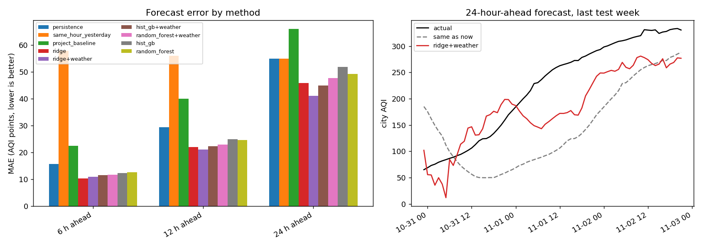

# ML forecast results

Generated 03 Nov 2026 00:44 IST from 1931 hourly city-mean AQI values (03 Aug to 02 Nov 2026).

**How it was tested.** Rolling-origin evaluation: 4 consecutive test windows of 7 days (07 Oct to 02 Nov). For each window the models are trained only on the past (with a gap of one horizon, so no target overlaps the test period) and scored on the window. Errors are in AQI points; lower is better. Weather features: included.

## 6-hour-ahead forecast

Scored on a 28-day back-test (4 rolling 7-day windows).

| method | MAE | RMSE | vs 'same as now' |
|---|---|---|---|
| ridge | 10.3 | 13.4 | +35% |
| ridge+weather | 11.0 | 13.7 | +30% |
| hist_gb+weather | 11.5 | 15.3 | +27% |
| random_forest+weather | 11.7 | 15.7 | +25% |
| hist_gb | 12.3 | 16.3 | +22% |
| random_forest | 12.6 | 16.4 | +20% |
| persistence | 15.7 | 20.7 | baseline |
| project_baseline | 22.5 | 29.3 | -43% |
| same_hour_yesterday | 57.9 | 73.9 | -268% |

Best model: **ridge**, lower MAE than 'same as now' in 3 of 4 test windows.

## 12-hour-ahead forecast

Scored on a 28-day back-test (4 rolling 7-day windows).

| method | MAE | RMSE | vs 'same as now' |
|---|---|---|---|
| ridge+weather | 21.1 | 25.2 | +29% |
| ridge | 22.0 | 27.2 | +25% |
| hist_gb+weather | 22.3 | 28.2 | +24% |
| random_forest+weather | 23.0 | 29.1 | +22% |
| random_forest | 24.6 | 29.8 | +16% |
| hist_gb | 25.0 | 30.5 | +15% |
| persistence | 29.5 | 37.8 | baseline |
| project_baseline | 40.0 | 50.8 | -36% |
| same_hour_yesterday | 56.0 | 71.7 | -90% |

Best model: **ridge+weather**, lower MAE than 'same as now' in 2 of 4 test windows.

## 24-hour-ahead forecast

Scored on a 28-day back-test (4 rolling 7-day windows).

| method | MAE | RMSE | vs 'same as now' |
|---|---|---|---|
| ridge+weather | 41.1 | 47.4 | +25% |
| hist_gb+weather | 44.9 | 52.8 | +18% |
| ridge | 45.9 | 56.5 | +16% |
| random_forest+weather | 47.7 | 55.5 | +13% |
| random_forest | 49.2 | 57.2 | +10% |
| hist_gb | 51.8 | 60.9 | +6% |
| persistence | 54.9 | 67.5 | baseline |
| same_hour_yesterday | 54.9 | 67.5 | +0% |
| project_baseline | 66.0 | 81.5 | -20% |

Best model: **ridge+weather**, lower MAE than 'same as now' in 2 of 4 test windows.

## MAE by method and horizon

Mean absolute error in AQI points, on a 28-day back-test (4 rolling 7-day windows). Methods ending in +weather use weather features.

| method | 6 h MAE | 12 h MAE | 24 h MAE |
|---|---|---|---|
| persistence | 15.7 | 29.5 | 54.9 |
| project_baseline | 22.5 | 40.0 | 66.0 |
| same_hour_yesterday | 57.9 | 56.0 | 54.9 |
| hist_gb | 12.3 | 25.0 | 51.8 |
| random_forest | 12.6 | 24.6 | 49.2 |
| ridge | 10.3 | 22.0 | 45.9 |
| hist_gb+weather | 11.5 | 22.3 | 44.9 |
| random_forest+weather | 11.7 | 23.0 | 47.7 |
| ridge+weather | 11.0 | 21.1 | 41.1 |

## Effect of weather features

Best model without weather vs best model with weather, on a 28-day back-test (4 rolling 7-day windows):

- 6 h: ridge 10.3 -> ridge+weather 11.0; weather raised the MAE by 6.7%.
- 12 h: ridge 22.0 -> ridge+weather 21.1; weather lowered the MAE by 4.3%.
- 24 h: ridge 45.9 -> ridge+weather 41.1; weather lowered the MAE by 10.4%.

## How to read this

- **'same as now' (persistence)** predicts that AQI stays where it is. It is hard to beat at short horizons.
- **project_baseline** is the statistical forecast in `src/forecast.py`, evaluated exactly as it would have been issued at each hour.
- **same_hour_yesterday** repeats the AQI from 24 hours before the target hour.
- The test period is only 28 days and the windows are correlated, so small differences between models are within noise.
- The test period covers the autumn rise in pollution; a model trained mostly on cleaner months faces a shifted distribution, which is why the models predict the change from the current AQI rather than the level.
- Weather features use the weather at the target hour, which assumes a weather forecast is available when the prediction is made.

